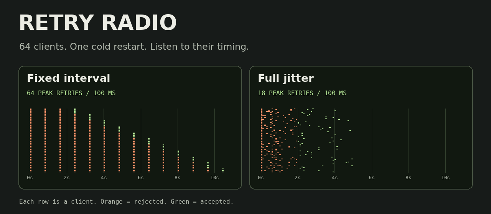

# Retry Radio

What does a retry storm sound like? Press play to hear 64 clients hit a service during a cold restart. Rejected requests crackle. Successful ones ring. Switch to **Full jitter** to hear what changes when the clients stop retrying in lockstep.

[Play Retry Radio](https://raw.githack.com/rajatwasan/rajatwasan.github.io/retry-radio/experiments/retry-radio/index.html) · [Download the standalone demo](https://github.com/rajatwasan/rajatwasan.github.io/raw/refs/heads/retry-radio/experiments/retry-radio/index.html)



## Try the 30-second comparison

1. Play **Cold restart** with **Fixed interval**. The clients arrive together and keep retrying every 800 ms.
2. Select **Exponential**. Listen for the longer silences. Every surviving client still chooses the same delay.
3. Select **Full jitter**. The bursts separate. Switch incidents or change the seed, then copy a replay link to share that exact configuration.

The default experiment starts 64 clients together and gives the service zero capacity for two seconds. After that it can accept six requests per 100 ms tick. With seed 42 the engine produces these results.

| Policy | Total retries | Peak retries in 100 ms | Last client succeeds |
| --- | ---: | ---: | ---: |
| Fixed interval | 502 | 64 | 10.4 s |
| Exponential | 438 | 64 | 34.4 s |
| Full jitter | 203 | 18 | 4.9 s |

The peak excludes the initial wave. Exponential backoff reduces attempts here, but clients still move together. Once the delay hits its cap, each group waits 3.2 seconds for its next turn despite spare service capacity between waves.

## Run locally

Download `index.html` and open it in a modern browser. The demo includes its simulation engine, renderer and synthesized audio. It runs offline. Audio starts when you press play.

For the CLI, use Node.js 20 or newer. These commands run from the project directory.

```sh
node cli.mjs
node cli.mjs --incident rolling --clients 128 --seed 7
node cli.mjs --incident brownout --policy jitter --seed 7 --json > trace.json
node --test
```

The JSON export contains each arrival, client ID, outcome, retry flag, per-tick capacity and completion count. Choose the same incident, seed and client count in the browser to replay it. The CLI supports 1 to 128 clients, and the browser offers 32, 64 and 128.

## Inside the experiment

- **Scheduling.** A map of future ticks holds due client IDs. Each client has one operation. Rejection schedules another attempt. Success removes the client from the simulation. Client ID breaks simultaneous-arrival ties.
- **Backoff.** Fixed retries wait eight ticks. Exponential retries wait 8, 16, then 32 ticks, with a 32-tick cap. Full jitter samples a uniform integer from 1 through the same ceiling. A one-tick floor prevents a retry from landing in the tick that rejected it.
- **Replay.** Each client has a deterministic random stream derived from the run seed and its ID. The CLI and browser use the same [engine](src/engine.mjs). Audio samples also use a deterministic generator.
- **Sound.** The [synthesizer](src/audio.mjs) turns each nonempty tick into a short sound. Rejection count controls crackle intensity. Successful arrivals add a pitched tone. The per-client raster preserves individual outcomes when many arrivals make one sound.
- **Scope.** This is a discrete-time teaching model with immediate responses, bounded per-tick throughput and deterministic tie-breaking. There is no server queue, request latency or retry budget. The reported times describe these scenarios.

Edit the modules in `src/` and run `node build.mjs` to regenerate the self-contained HTML. The build, CLI and tests use Node's standard library.
